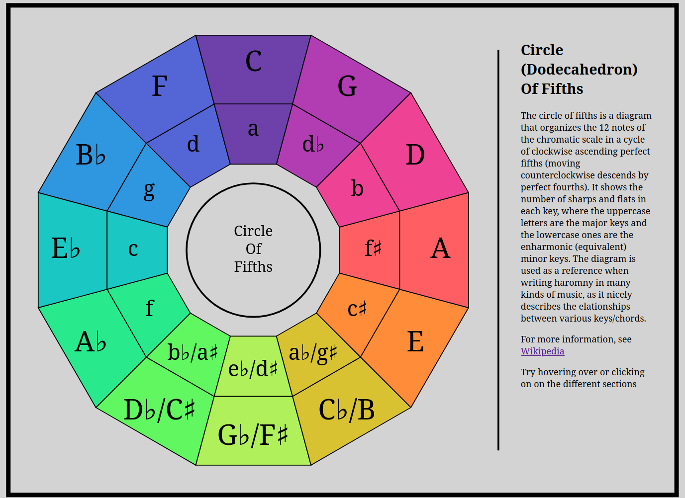

# Dodecagon of FIfths
## Submission for Assignment 1 of CS4804 B26
### Param Amre

[Github Pages Link]()

My submission for this assignment is a visualization of the circle of fifths, a diagram
used in music that shows all 12 keys, arranged in a clockwise circle of ascending perfect
fifths. The diagram shows the  relationship between different keys, including the number of
accidentals in each major and minor key, and can be used to write harmonies.

Each key in the diagram can be hovered over or clicked on to show the accidentals in that
key, in ascending order.

### Code Sources/AI Use
My code isn't based on anything specfic, I did used the following d3 examples as a basis for
some parts of the diagram.

- [d3-shape lineRadial examples](https://observablehq.com/@d3/d3-lineradial)
- [d3-shape areaRadial example](https://observablehq.com/@d3/radial-area-chart/2)

LLMs were used for some debugging. It was also used  as a way to get documentation information
when I couldn't find any answers on how to do a specific thing, since I'm not very familiar
with Javascript.

### Design and Technical Achievements
I believe the interactivity is a technical achievement, as it wasn't the scope of the original
assignment. I believe it also is a design achievement, as the interactivity makes the diagram
look nicer while still preserving all the information that a standard (basic) diagram provides. I
wanted to do this because [normal circle of fifths diagrams fit this information in awkwardly](https://www.google.com/search?udm=2&q=circle+of+fifth)
, usually around the edges.

